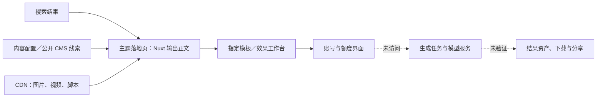

# PicLumen 与 Media.io：从一个热门搜索词到付费视频工具

这两张页面最值得学习的，是把用户已经想要的一个具体视频效果，做成了能够被搜索、被理解、被试用的产品入口。它们把“我想做这种视频”直接连接到预设模板，省掉用户学习模型、提示词和剪辑流程的成本。

PicLumen 更强调首屏直接操作、电影感样片和平台可信度。Media.io 更强调作品展示、剧情方法、可复用提示词和效果工作台。两者都在经营一组可持续扩展的搜索入口，而不是只围绕一个关键词写文章。

## 1. 先看结论

| 判断 | 证据与边界 | 对我们的意义 |
|---|---|---|
| 江昪观察到的排名有现场支持 | 2026-10-27 约 18:56 的 Google 英文搜索样本中，Media.io 为第一个普通网页自然结果，PicLumen 第二；Media.io 命中英文页 | 值得研究这个结果组合，但不能称全球、全时段排名 |
| PicLumen 的信任感有具体设计来源 | 首屏展示成片、双人物上传框、固定模板、完整产品导航和外部评价 | 最有价值的是降低“能否做出来、如何开始”的不确定性 |
| Media.io 的内容更贴近实际创作困难 | 人物角色、情绪转折、匹配转场、换脸异常等说明，四个不同场景提示词 | SEO 内容可以成为产品使用帮助，不能只堆形容词 |
| Media.io 拥有明显更大的站点基础 | Semrush 同月全站访问估算 894 万 vs 132 万，引用域 1.258 万 vs 3,770 | 排名不能只归因于页面排版，域名积累是需要考虑的混杂因素 |
| 两页都是可规模化的模板入口 | Nuxt 服务端输出内容，公开配置有模板／工作流标识；站点地图有大量相关页面 | 可复用生成能力与可复用内容模块，才是扩张成本的关键 |
| 基础 SEO 分数很好，移动端体验有明显代价 | Lighthouse SEO 都是 100；手机端性能分别 37、30，单次加载约 45–49 MiB | 不应把“能排名”理解成实现已经优秀 |
| 信任承诺和实际入口之间存在缺口 | PicLumen 部分语言替代页 404、提示词截断；Media.io 中文页混英文、两照片承诺与初始单上传框不一致 | 学它们的组织方法，同时把兑现承诺做得更准确 |

以上包含实测事实、第三方估算和分析推断。后文分别标注，未取得页面级流量、收入或生成成功率，不以完整报告的名义补造这些数字。

## 2. 搜索入口：先分清联想词、排名与搜索需求

江昪在 2026-10-27 提供的发现路径是：输入 `AI video Z`，联想词中 `ai video zombie love` 第一；进入搜索结果后，被 PicLumen 的页面结构说服，产生试用意愿；随后补充 Media.io 当前排第一。这是用户的真实搜索样本。

本次另做两项独立观察：

| 检查 | 结果 | 不能据此推出什么 |
|---|---|---|
| Google 搜索 `ai video zombie love`，`hl=en&pws=0` | 普通网页自然结果依次为 Media.io、PicLumen、Renoise；之后还有视频结果模块及其他工具 | 不是长期排名跟踪，也不是无账号、无地域影响的统一榜单 |
| Google autocomplete，英文、Firefox client 参数，输入 `ai video z` | `ai video zombie love` 排第四，前面为 zombie、zoom out、zone | 不能否定江昪看到第一；两个请求的时间、环境和个性化条件不同 |

搜索样本来自现有 Chrome 登录环境，未指定国家；`pws=0` 不能消除所有环境影响。联想词会参考语言、位置、趋势及历史等条件，因此联想第一不等于搜索量第一，更不等于某网站排名第一。[Google 对联想预测的说明](https://support.google.com/websearch/answer/7368877?hl=en)

还有一个容易混淆的地方：**本次 Google 第一名是 Media.io 英文 URL，用户提供的是中文 URL。** 后文产品体验按中文页及其创作工作台检查；搜索命中与英文对应页单独核对，不能把中文页的每个问题都直接归因到英文页排名上。

这组关键词的意图可拆成三层：

| 用户当下想解决的问题 | 合适的承接内容 | 两站的做法 |
|---|---|---|
| “是不是我看到的那个拥抱、变异、回忆的视频？” | 可立即辨认的样片 | 大视频／效果卡片先证明理解同一个梗 |
| “能不能把主角换成我和另一个人？” | 角色输入、素材要求、固定模板 | PicLumen 首屏双人物框；Media.io 引到效果工作台 |
| “怎么保证脸不乱、转场自然？” | 具体提示词、角色约束、失败修复 | Media.io 的角色和转场说明更充分 |

**分析推断：**这个主题同时包含视觉猎奇、人物代入和情感反转，适合形成“看到短视频 → 搜索制作方法 → 使用模板”的需求。当前页面文案支持这种承接策略，但本次没有社交平台传播曲线或 Google Trends 时间序列，不能断言趋势起源、峰值日期或增长速度。

## 3. PicLumen：为什么一眼让人愿意试

实际页面：[Zombie Love Story 页面](https://www.piclumen.com/effects-zombie-love-story/)。桌面采用浅色背景、紫色主按钮和标题强调；左侧保持完整产品侧栏。它让用户进入时就站在产品内部，而不是先读完一篇教程才找到工具。

### 3.1 页面从上到下，各部分在解决什么

| 页面部分 | 实际观察 | 可能的设计目的与作用 |
|---|---|---|
| 促销横幅与产品侧栏 | 首月优惠；工作室、模型、资产、社区等入口 | 暗示产品规模，展示继续使用的空间；也会分散当前任务注意力 |
| 首屏标题与结果样片 | 标题直接对应僵尸爱情视频与免费使用；电影感示例占较大面积 | 确认搜索意图，让用户先判断“这是不是我要的效果” |
| 嵌入式生成区 | 已选模板，两个角色上传位、参考视频、生成按钮 | 把开放式创作压缩成填两个输入；无需先理解模型参数 |
| 更多提示词 | 一个拉美场景版本，包含分镜与时间安排 | 服务想自己改剧情的人，增加内容深度和可复制性 |
| 六个热门效果卡片 | 展示相邻玩法 | 当前主题不合适时保留用户；形成相关页面内部链接 |
| 情侣、宠物、最后拥抱等用途 | 从效果解释转向使用场景 | 帮助用户把样片映射到自己的照片和情感关系 |
| 五组价值说明 | 易用、情绪、角色等卖点 | 回答犹豫者的异议，但其中存在内容重复 |
| Trustpilot 评价区 | 品牌评分、评价数量、用户评论 | 让外部评价为平台可靠性提供支持 |
| 七项 FAQ | 流程、人物与使用相关答疑 | 解决操作顾虑；具体额度、时长仍不够清楚 |
| 分类页脚 | 大量工具、模型、教程与效果链接 | 支持跨主题发现与爬虫导航，也展示平台广度 |

这些模块形成一个心理顺序：**认出效果 → 相信能做 → 知道怎么开始 → 想象自己的成片 → 减少顾虑 → 点击生成。** 用户感受到的“结构好”，很可能来自这个顺序，而不只是配色或间距。这个解释是设计推断，尚无转化实验佐证。

### 3.2 实际点击发生了什么

未上传素材时点击生成，出现登录／注册弹窗，可通过 Google、Apple 或邮箱继续。弹窗再次展示创作者评价，强化进入账号流程的理由。本次没有提交账号信息，也没有消耗生成额度。

这意味着首屏“可操作”已经建立，但真实首个结果前至少还有账号和素材门槛。是否保留已填输入、登录后是否仍选中该模板、实际扣多少积分、失败是否退回，本次没有跨过登录门槛验证。

### 3.3 看起来很完整，但不能照抄的细节

- 右上注册浮层遮挡了部分首屏标题／展示区。它可能提高注册曝光，同时伤害第一次理解产品的过程，需要实测净收益。
- 更多提示词模块的英文内容在 `lunges forwa` 处中断。源码和渲染文本都如此，属于内容本身截断，不能按完整可复制提示词宣传。
- 开场介绍与后面的价值说明出现重复段落，内容长度增加了，新增信息未同比增加。
- FAQ 对模型和流程使用弹性措辞，而 meta description 对保留镜头、表演、转场和声音的承诺很强；用户预期可能高于实际可保证的范围。
- 首屏没有把此次生成的额度、输出规格和等待时间说清楚。“免费”很容易被理解得比实际范围更广。

## 4. Media.io：排名第一的页面在做什么

检查对象为[中文页](https://www.media.io/ai/zh/explore/zone/zombie-love-story-ai-video-generator)及[英文对应页](https://www.media.io/ai/explore/zone/zombie-love-story-ai-video-generator)。页面采用深色工作台外观、紫色行动按钮和 Wondershare 品牌标识。

### 4.1 展示层与内容层分工更明显

| 页面部分 | 实际观察 | 设计目的分析 |
|---|---|---|
| 工作台外壳 | 视频、图片、音频、角色、资产、探索及效果等导航 | 给用户一套已有生产工具的感觉，借品牌与产品广度降低陌生感 |
| 顶部视频案例 | 三个示例轮播 | 先用结果定义玩法，优先吸引只看效果的用户 |
| 投稿区 | 三个条目，同一作者 tengyy，显示 16、10、8 等计数 | 营造可参与的作品场景；仅凭三个同作者条目不足以证明活跃社区 |
| 剧情方法 | 情绪四拍、角色一致、匹配转场、情侣／宠物变体 | 把页面从“卖工具”延伸到“教用户做得更好” |
| 三步制作说明 | 素材、设置和生成相关流程 | 为新手建立可预期的操作路径 |
| 四个不同提示词 | 木屋、雨城、宠物、海岸等情境 | 承接想修改剧情的搜索者，也让同一底层功能服务多个场景 |
| 五项 FAQ | 涉及人物交换、面部异常、转场等问题 | 比泛泛的功能问答更接近真实失败场景 |
| 相关推荐与底部行动区 | 其他效果、提示词和部分时尚主题链接 | 形成内容网络；不相关链接也暴露推荐模块的粗糙程度 |

浏览器中提示词轮播有重复节点，四个独特提示词并不等于十几个独立内容模块。源码层与渲染层的数量不能混算。

### 4.2 创作路径比 PicLumen 多一道选择

本次实际路径：

`落地页下方创作按钮 → 滚回效果区 → 悬停效果卡片 → 点击去创作 → 新标签页工作台`

最终工作台 URL 带有 `uni_fun_code=effects_video_viral_zombie_trend`，说明内容页导向指定效果流程，而非无差别打开首页。这个衔接是优点：用户不用再次搜索模板。

但有两处摩擦：第一，下方主要按钮没有直接进入创作；第二，落地页承诺两张照片，工作台初始状态只有一个可见上传区。**本次只能确认首屏信息不一致，不能断言上传后无法加入第二个人物。** 未上传文件，生成按钮保持禁用，因此没有验证实际产物。

### 4.3 它的内容为什么更有 SEO 竞争力

**分析推断：**Media.io 同时覆盖“找生成器”和“找提示词／教程”两类需求。标题明确包含 Prompts，正文又具体解释角色和转场，使搜索者即使暂不注册，也能获得有用方法。这能增强页面与多个相关查询的匹配。

但排名领先是否由这些内容造成，无法从两张页面的横向观察中证明。域名积累、页面外链、发布时间、用户群体及搜索环境都可能影响结果。

## 5. 信任感审计：哪些可信，哪些只是展示

| 信任信号 | 本次能证实的部分 | 仍需保留的边界 |
|---|---|---|
| PicLumen 的 Trustpilot 4.8 分 | 外部 Trustpilot 页面确有 4.8 分，访问时 4,486 条评论 | 属于品牌评价，不能直接证明此视频模板的成功率 |
| PicLumen 页面的 4,345 条评价 | 源码结构化数据写 4,345；Google 此次星级摘要也显示此数 | 与外部最新数有差异；页面评论多为通用图片生成体验 |
| PicLumen 的千万创作者等数字 | 页面自身如此宣称 | 未取得独立审计或活跃用户口径 |
| Media.io 的 4.7 分、162,357 票 | 页面及结构化数据确有展示 | 是站方工具质量评价口径，本次未取得独立第三方佐证，不宜称该模板用户评价 |
| 完整导航、资产与工作台 | 实际存在对应界面入口 | 证明产品结构，不证明每个功能稳定、盈利或有自研模型 |
| 精美视频样例 | 页面确实展示了结果视频 | 不代表任意用户素材都能一次复现，也没有排除筛选、重试或后期处理 |

外部评分来源：[Trustpilot 的 PicLumen 页面](https://www.trustpilot.com/review/piclumen.com)。

**最值得学的是把信任证据放在用户犹豫的位置；需要改进的是让证据明确对应它能证明的事情。** 平台级口碑、模板级样例和当前用户的成功结果，应当分开呈现。

## 6. 第三方数据：两个站点的规模与流量结构

以下均为第三方估算，不是站方 GA4 或收入后台。访问日期为 2026-10-27；主要统计月份为 2026-09，早于本次观察的十月主题页面元数据，不能拿九月全站增长证明这个页面带来的效果。

### 6.1 Semrush：同工具、同月份比较

| 指标 | PicLumen | Media.io |
|---|---:|---:|
| 全站访问量 | 132 万 | 894 万 |
| 环比 | +25.77% | -0.04% |
| 每次访问页数 | 3.96 | 2.62 |
| 平均访问时长 | 6 分 06 秒 | 5 分 18 秒 |
| 跳出率 | 49.00% | 54.44% |
| Authority Score | 46 | 61 |
| 引用域数量 | 3,770 | 12,580 |
| 外链数量 | 97,940 | 858,440 |

来源：[Semrush PicLumen](https://www.semrush.com/website/piclumen.com/overview/)、[Semrush Media.io](https://www.semrush.com/website/media.io/overview/)。上述访问数据为全域估算；权威分数是 Semrush 的自有指标，不是 Google 官方分数。

同一工具下，Media.io 全站访问估算约为 PicLumen 的 6.8 倍。它能支持“Media.io 有更大的站点基础”这一判断，不能支持“这个僵尸页面流量大 6.8 倍”。外链也没有下钻到目标 URL，无法判断两张具体页面谁获得更多有效链接。

Semrush 公开页还显示自然搜索估算 132.8K 与 1.48M，但页面关键词数据库分别出现孟加拉国与印度口径。这里保留观察，不把它们与全球总访问量相除，更不拿两个国家关键词列表比较目标词需求。

### 6.2 Similarweb：交叉验证，不拼接成一个精确数字

| 指标 | PicLumen | Media.io |
|---|---:|---:|
| 比较区显示的访问量 | 716K | 3.4M |
| 每次访问页数 | 3.38 | 2.52 |
| 平均访问时长 | 1 分 38 秒 | 1 分 24 秒 |
| 跳出率 | 44.94% | 44.97% |
| 桌面端主要渠道 | 直接访问 47.53%，自然搜索第二 | 自然搜索 62.09%，直接访问第二 |
| 显示的关键词数量 | 9.4K | 62.8K |

来源：[Similarweb PicLumen](https://www.similarweb.com/website/piclumen.com/)、[Similarweb Media.io](https://www.similarweb.com/website/media.io/)。页面选中 September 2026；访问量数字来自 Compare 区，其邻近图表标题为过去三个月总访问量，本次未导出底层时间序列，因此不拿该数字做严格的月度增长推算。

两家工具给出的访问量和访问时长差异很大。正确处理是保留来源和口径：不能取平均后称为真实流量，也不能把差值包装成统计置信区间。二者共同支持 Media.io 更大；Similarweb 的渠道估算还支持其对自然搜索依赖较强。

另一个常见误读：Similarweb 的 98.41%／99.81% 是两站**搜索流量内部**自然与付费的比例，不是全站流量中 SEO 的占比。

### 6.3 这次没有取得的数据

目标词月搜索量、关键词难度、CPC、两个目标 URL 的月访问量、历史排名曲线、页面外链明细、注册率、首次生成成功率、付费率、CAC、LTV 和收入均未取得。它们需要相应付费数据、站方 Search Console／GA4 或业务后台；公开站点结构不能替代这些数据。

## 7. 页面 SEO：真正做了哪些工作

两张目标页的初始 HTML 已包含正文内容，并非只返回空应用壳；均能返回 HTTP 200。下面的代码数量来自本次源码快照，不代表 Google 实际采用的页面版本。

| 检查项 | PicLumen | Media.io 中文页 | 判断 |
|---|---|---|---|
| Title | 47 个字符，主题＋生成器＋品牌 | 57 个字符，主题＋生成器／提示词＋品牌，仍为英文 | 都直接对齐搜索意图；Media.io 扩展到提示词需求 |
| Meta description | 251 个字符，承诺较密集 | 简洁说明两张照片、剧情及转场，英文 | 长度不是直接处罚标准，但信息要与真实能力一致 |
| H1 | 1 个 | 2 个，中文区标题及英文内容标题 | 两个 H1 不等于无法排名；统一页面主标题更清楚 |
| H2／H3 | 6／17 | 7／12 | 具备层级，但数量本身不是质量指标 |
| Canonical | 自指目标页 | 自指中文目标页 | 页面身份基本明确 |
| Hreflang | 11 个语言／地区码＋x-default | 13 个语言／地区码＋x-default | 有国际化意图，必须再验目标能访问且互相对应 |
| 结构化数据 | FAQPage、SoftwareApplication | BreadcrumbList、WebApplication、HowTo、FAQPage、Product | 标记丰富不等于排名更高或必有富结果 |
| 视频结构化数据 | 未发现 VideoObject | 未发现 VideoObject | 可检查真实示例视频是否符合条件，再考虑补充 |
| 社交分享图 | og:image 空，未发现有效 twitter:image | 通用品牌分享图，1200×630 | PicLumen 分享预览有缺口；Media.io 可进一步用模板专属封面 |
| HTML 链接节点 | 140 个 | 60 个 | 包含全局导航，不等于独立推荐页数量 |
| 图片 alt | 19 个图片节点中 3 个为空 | 34 个中 25 个无 alt | 要区分装饰图与信息图，不能把所有空 alt 都判成错误 |

基础来源为两张目标页源码；归档目录中的 `target-parsed.json`、`media-parsed.json` 保留解析结果。源码统计用于检查实现，不冒充搜索引擎实际收录量。

### 7.1 评分确实出现在搜索结果，但语义要准确

PicLumen 的 SoftwareApplication 标记带品牌级 aggregateRating，本次 Google 搜索结果展示了 4.8 分和 4,345 条评价。这里可以确认“评分被展示”，不能确认“因为评分所以第二名”。

复制这种做法前，应先确定评价对应的是哪个软件实体，页面是否清楚显示来源与范围，不能把平台口碑改写成某个模板的专属评价。Google 也明确指出，符合结构化数据规范并不保证展示富结果。[结构化数据通用规范](https://developers.google.com/search/docs/appearance/structured-data/sd-policies)

### 7.2 FAQ 有价值，但不要沿用过时的富结果理由

两站都写 FAQPage。然而 Google 当前文档记录：**FAQ 富结果自 2026-05-07 起不再展示。** 因此，这次不能把 FAQ schema 当作增加搜索结果折叠问答的现行手段。FAQ 应保留，是因为它能回答真实问题，而不是为了追逐已退出的展示样式。[Google 更新记录](https://developers.google.com/search/updates)

若补视频标记，应围绕页面真实可见、可播放的示例，提供准确的封面、名称、时间等字段；并不意味着所有带视频的销售落地页都自动获得视频富结果。[Google VideoObject 文档](https://developers.google.com/search/docs/appearance/structured-data/video)

## 8. 站点结构：它们为什么值得为一个梗单独做页面

### 8.1 PicLumen：效果、模型、教程与场景互相连接

[robots.txt](https://www.piclumen.com/robots.txt)没有阻挡目标页，并将部分账号、任务等应用路径排除。站点地图索引有 14 个子地图，包含 pages 和 13 个 gallery 子表；本次完整解析 pages 子表，得到 936 个唯一 URL。

其中按路径机械统计，有 78 个 `/effects-` URL、51 个 `/model/` URL；还包括 solution、hub、blog、视频生成器、教程、图片生成器等类别。这不是全站所有公开页面数量，更不是 Google 收录数量。

目标页在 sitemap 中的 lastmod 为 `2026-10-09T00:20:12Z`，还存在僵尸新娘等相邻主题。lastmod 是站方声明的更新时间，不能当作首次发布时间。

**分析推断：**它用效果词承接具体需求，用模型页承接模型认知，用教程降低操作门槛，再把访问带回同一个工具和账号体系。一种底层能力可以服务多个搜索入口。

### 8.2 Media.io：更大规模的主题区与工具网络

本次完整解析 Media.io 主 sitemap，得到 7,377 个唯一 URL，其中包含：

| 路径类别 | 本次主地图中的 URL 数 |
|---|---:|
| `/explore/zone/` | 1,369 |
| `/ai-prompts/` | 842 |
| `/ai/image-to-image/` | 634 |
| `/image-effects/` | 482 |
| `/audio-effects/` | 477 |
| `/video-effects/` | 132 |

其他类别还包含色彩工具、对比页等。以上是一个主地图的分类数量，不能与 PicLumen pages 子表直接当作两站总规模比值。Media.io robots 声明了主地图及多个区域地图，本次没有全量解析所有语言地图。

主地图里找到 9 个含 zombie 的 URL，覆盖妆容、声音、提示词、新娘、趋势与爱情故事等。英文目标页 lastmod 为 2026-10-13，页面还自报内容创建日 2026-10-06，以及 `content-strategy=trending`、`content-source=staff_written`。

这些公开字段支持“有趋势选题和内容发布流程”的推断，但员工撰写是站方声明，不能据此排除 AI 辅助写作，也不能推算内容团队人数。来源入口：[Media.io robots](https://www.media.io/robots.txt)、[Media.io sitemap](https://www.media.io/sitemap.xml)。

### 8.3 为什么独立 URL 比只在 App 里放一张模板卡更有价值

独立页可以有自己的标题、摘要、示例、问答和内部链接，承接非常具体的查询；用户不用先进入工具再找效果。随后，模板 ID／工作流编码把内容页与共享生成系统连接起来。

这使新增页面的成本主要集中在验证模板、制作样例和补足独特内容。**只有每页真的解决一个不同需求，这种扩张才有用户价值。** 大量同义页面、无效语言页和泛泛段落，会增加维护成本，并不能由两个成功样本证明它们有利于增长。

## 9. 国际化：有 hreflang 不等于本地化已经做好

PicLumen 目标页声明了中文和德文替代 URL，本次跟随这些实际声明的地址检查：

- `https://www.piclumen.com/zh/effects-zombie-love-story/` 返回 HTTP 404。
- `https://www.piclumen.com/de/effects-zombie-love-story/` 返回 HTTP 404。

这是抽样确认的两个断链，其他语言未逐个检查。问题在于页面对搜索引擎宣称存在语言对应关系，但抽查目标不可用；应修复路由或移除不存在的声明。

Media.io 中文 URL 的页面语言设为 zh-CN，但 title、description 和大段 SEO 正文仍为英文；应用外壳与内容呈现混合语言。中文页自指 canonical，但 Breadcrumb 和 WebApplication 的 URL 字段仍指英文页。英文对应页则有自己的 canonical 和语言替代链接。

这些问题更像复用模块时没有完整处理语言及实体字段。它们不证明网页一定不能收录，却说明国际化上线需要逐页验收：状态码、正文、标题、工作台语言、canonical、hreflang、结构化数据应彼此一致。

## 10. 前端与后端：公开证据能看见多深

本次是外部技术观察，没有内部后台权限。可见的是前端框架、公开服务地址、模板绑定、静态资源、响应头与分析脚本；看不到数据库、队列实现、GPU、模型合同、源码仓库或实际推理服务。

| 证据层 | PicLumen | Media.io | 能得出的结论 |
|---|---|---|---|
| 页面框架 | Nuxt、SSR 标记、Pinia／i18n 相关状态 | Nuxt、SSR 内容、嵌入 SEO 内容模块 | 应用与可抓取内容结合；不是确认内部全部技术栈 |
| 服务边界 | `api.piclumen.com/api`、`cms-api.piclumen.com/cms` | `vapi.media.io`，公开状态中出现 workflow zone 信息路径 | 存在 API／内容服务分工；未发起私有任务调用 |
| 模板绑定 | templateDetail、templateId、modelId 等状态字段 | zone slug 与指定 effect code 创作 URL | 内容页与可复用模板／流程有关联 |
| 静态资源 | 独立 statics、images、publish 子域；CloudFront 响应痕迹 | 独立 vapps-res 静态资源域 | 有资源分发层，不代表掌握所有源站部署细节 |
| HTTP | nginx、Nuxt；本次 HTML 响应缓存一周并带 immutable | nginx、Nuxt；本次 HTML no-store；HSTS | 缓存策略不同；PicLumen 应核模板与价格更新是否及时失效 |
| 分析代码 | Clarity、gtag／事件队列 | GTM、首访来源记录 | 有行为／来源采集能力；未证明转化归因配置正确 |
| 账号／交易 | 登录入口，Lumen 额度体系 | Wondershare 账号 SDK、商店脚本及定价购买入口 | 可见统一账号与计费连接，不证明具体支付后台实现 |

从公开证据推导的简化架构如下，虚线部分未实际访问：

**不能下的结论：**“他们自研了这个模型”“一定调用某一家模型 API”“后端是 Python／某数据库”“每条视频成本多少”“某个公开 API 地址可以无账号生成”。当前证据都不足。

## 11. 性能与移动端：漂亮的桌面首屏有成本

直接 PageSpeed API 首次请求遇到配额 429，随后通过浏览器打开官方 PageSpeed Insights，成功完成两次手机端报告。不是只看网页主观感受，也没有把失败请求当有效测量。

### 11.1 同配置实验室单次测量

2026-10-27 18:57 左右，Lighthouse 13.5.0、模拟 Moto G Power、慢速 4G、首次加载：

| 指标 | PicLumen 目标页 | Media.io 中文目标页 |
|---|---:|---:|
| Performance | 37 | 30 |
| Accessibility | 72 | 91 |
| Best Practices | 96 | 73 |
| SEO | 100 | 100 |
| 首次内容绘制 FCP | 8.7 秒 | 8.7 秒 |
| 最大内容绘制 LCP | 17.7 秒 | 72.6 秒 |
| 总阻塞时间 TBT | 740 毫秒 | 1,300 毫秒 |
| 布局偏移 CLS | 0.072 | 0.043 |
| 总网络载荷 | 46,286 KiB，约 45.2 MiB | 50,015 KiB，约 48.8 MiB |
| 潜在未使用 JS | 约 792 KiB | 约 1,832 KiB |

来源：[PicLumen PSI 报告](https://pagespeed.web.dev/analysis/https-www-piclumen-com-effects-zombie-love-story/zcmnmn7l98?form_factor=mobile)、[Media.io PSI 报告](https://pagespeed.web.dev/analysis/https-www-media-io-ai-zh-explore-zone-zombie-love-story-ai-video-generator/ze3hgivzgd?form_factor=mobile)。

72.6 秒是本次模拟环境的一次测量，不能写成“Media.io 用户普遍要等 72 秒”。若用于性能预算或上线验收，需要重复运行并看分布。本次共同暴露的问题是载荷大、JavaScript 成本高；自动播放视频、全量工作台资源等是需要进一步归因的候选，不是已证明的唯一原因。

### 11.2 真实用户数据的粒度不一样

| CrUX 手机端过去 28 天 | PicLumen | Media.io |
|---|---|---|
| 数据范围 | 目标 URL | 整个 origin；此 URL 无独立数据 |
| LCP | 1.6 秒 | 4.0 秒 |
| INP | 205 毫秒 | 478 毫秒 |
| CLS | 0.03 | 0.07 |
| Core Web Vitals 判定 | 未通过 | 未通过 |

因此，不能把两列都称作“这张页面的真实用户性能”，也不能用 Media.io 全域数据证明此中文页实际延迟。PicLumen 实验室与现场的差距，也说明缓存、设备、网络和采样群体会影响读数。

### 11.3 手机截图暴露了什么

Lighthouse 的 PicLumen 手机首屏里，标题占多行，说明文案很长，主要操作和完整示例被推到下方。Media.io 手机截图则出现每日免费积分弹窗，覆盖大部分内容。后者仅为本次实验室会话状态，不代表所有访客每次必定看到。

这些截图支持两项优化方向：缩短手机首屏文案，让样例和主操作更早出现；避免新用户尚未理解产品就被权益弹窗遮挡。本次浏览器 viewport 覆盖没有实际生效，已撤销；移动端视觉结论来自 Lighthouse 截图，未冒充手工完成手机交互测试。

**SEO 100 分只说明 Lighthouse 那组基础检查通过，不能覆盖内容质量、排名、国际化正确性、评价语义和完整用户体验。**

## 12. 定价与商业承接：为什么“免费”值得仔细看

定价为 2026-10-27 页面显示，促销、地区和税费可能改变最终金额；下表是年付折算月价，不是逐月扣款价。

| 产品 | 页面显示的套餐例子 | 和这个落地页的关系 |
|---|---|---|
| PicLumen Lite | $6.09／月，750 Lumens，约 30 条视频 | 通过额度引导升级；实际模板扣费未验证 |
| PicLumen Standard | $19.99／月，2,500 Lumens，约 100 条视频 | 更高额度及权益，使用频率上升后承接付费 |
| PicLumen Pro | $37.49／月，6,000 Lumens，约 240 条视频 | 面向更高频使用；近似视频数不能反算所有模型固定成本 |
| Media.io Free | 每日签到 3 积分、最多约 1 条视频，720p、有水印 | 免费体验与额度约束同时存在 |
| Media.io Standard | $7.99／月，年付 $95.88；200 积分，最多约 20 条视频 | 1080p、无水印等权益承接导出需求 |
| Media.io Premium | $13.99／月，年付 $167.88；600 积分，最多约 60 条视频 | 更高额度、存储等承接持续使用 |

来源：[PicLumen 定价](https://www.piclumen.com/pricing/)、[Media.io 定价](https://www.media.io/pricing.html)。Media.io 价格已在浏览器中读取动态加载后的卡片，未使用源码中的未渲染价格占位符。

PicLumen 定价还区分不同套餐的商业使用权益，不能因为生成页出现 Free 就默认免费产物可商业使用。这里记录站方套餐表的区分，不代替具体许可审核。Media.io 的免费签到额度、订阅试用和促销年付也是三个不同概念，不能混成永久免费。

**分析推断：**热门效果负责带来第一次尝试；水印、清晰度、生成额度和持续使用负责把兴趣转换成付费。模板之间的交叉推荐，则把一次性热点用户引到更长期的创作需求。实际付费效果仍需漏斗数据验证。

## 13. 为什么必须设计这样一张页面

这一页同时承担五份工作：

1. **对搜索引擎定义需求。** 专属 URL 和正文让一个细分效果拥有独立搜索入口。
2. **对用户证明理解。** 视觉样片比一段“强大的 AI 视频能力”更快确认双方说的是同一种效果。
3. **把复杂创作产品化。** 用预设角色、剧情和模板，将模型选择、提示词和分镜知识收进默认流程。
4. **让陌生访问者愿意交出素材。** 产品外壳、样例、步骤和评价依次降低疑虑；具体隐私与价格信息仍应更早出现。
5. **让单个主题进入长期商业关系。** 账号、资产、额度和其他模板把一次访问连接到再次生成、导出和订阅。

从经营角度，可用下面的公式评价这种页面，而不是只看排名：

`页面贡献 = 搜索进入人数 × 开始创作率 × 首次成功率 × 付费率 × 单用户贡献毛利 − 内容维护成本 − 免费试用生成成本`

其中生成成本要计入失败与重试，付费归因要明确窗口，并区分新客与已有用户。这个公式是建议的经营模型，本次没有足够数据代入真实值。

“页面为什么这么长”也有答案：不同用户在不同位置做决定。立即行动的人在首屏进入，想学方法的人继续看提示词，犹豫者看评价和 FAQ，暂时不喜欢该主题的人看相邻效果。长页面的价值取决于每一段是否解决新的问题，不能用字数本身评价。

## 14. 两站分别最值得借鉴什么

| 维度 | 更值得参考的做法 | 应同时修正的问题 |
|---|---|---|
| 首次理解与操作 | PicLumen 把样例与输入放在同一个视野 | 手机端缩短标题，避免注册浮层遮挡 |
| 教学与内容深度 | Media.io 的角色、转场和失败修复内容 | 中文页面完整本地化，清理不相关链接 |
| 从内容到工具 | 指定模板／effect code，带着用户意图进入 | 直接进入目标流程，保持输入及人物要求一致 |
| 信任设计 | PicLumen 有可外查的品牌评价 | 清楚区分平台口碑和模板实测 |
| 搜索页面扩张 | 统一模板、主题簇、相邻效果内链 | 先保证独特价值及可用性，再扩大数量 |
| 商业转化 | 免费体验与付费额度、导出权益连接 | 在生成前明确实际成本、限制与失败处理 |
| 技术实现 | 正文、元数据和可用入口有明确结构 | 按需加载工作台与视频，不把所有资源压进首屏 |

对新产品而言，最值得做的组合是：**PicLumen 的首屏可操作性＋Media.io 的具体创作帮助＋更清楚的价格和结果承诺。** 这是一项待实验的设计建议，不是已验证优于两站的结论。

## 15. 如果借鉴，建议怎样落地与验证

### 15.1 先做少量真实可交付的效果页

第一批选择 5–10 个已有真实需求迹象、且能稳定生成的效果。每个页面至少有：实际生成样例、明确输入要求、直接打开目标模板的按钮、可兑现的费用与输出说明、一段独特使用帮助、真实失败案例及修复方式。

不要只从联想词顺序判断需求。应同时记录目标地区 SERP、需求来源、现有产品能否满足、试用成本和竞争页面缺口。没有真实样例或无法稳定生成的主题，先补产品能力再上线搜索页。

### 15.2 推荐页面顺序

`一句话说明效果 → 可播放样例与输入 → 费用／规格／等待时间 → 三步操作 → 具体变体和提示词 → 失败与修复 → 有来源的评价 → FAQ → 少量相关效果`

手机端先让用户看见样片、所需素材和主操作。账号可以出现在必要时机，但应保留用户输入。若领取积分不是完成当前任务的必要条件，不应先遮住整页。

### 15.3 需要记录的事件与判据

| 阶段 | 建议记录 | 能回答的问题 |
|---|---|---|
| 搜索可见度 | Search Console 的页面、查询、国家、设备、日期 | 是没展示、没人点，还是点击后流失？ |
| 页面理解 | 样例播放、主 CTA 点击，带 template_id 与 locale | 用户是否认出并愿意尝试这个效果？ |
| 素材准备 | 上传开始／完成／失败，按角色位置区分 | 是素材要求不清楚，还是上传技术问题？ |
| 账号流程 | 登录出现与完成、原模板是否保留 | 是否在账号步骤丢失用户或上下文？ |
| 生成结果 | 任务接受、成功／失败、耗时、扣费与退款 | 页面承诺是否能兑现？成本来自哪里？ |
| 商业价值 | 预览、下载、再次生成、付费，标明归因窗口 | 用户得到价值以后是否愿意继续使用？ |

事件不应采集人物照片或敏感内容到分析系统。技术上优先使用必要的匿名事件与任务状态，具体数据治理按实际产品要求确定。

### 15.4 优先实验，而非一次改完所有东西

| 实验 | 假设 | 主指标与保护指标 |
|---|---|---|
| 首屏内嵌输入 vs 直接进入预选模板 | 不同设备对操作复杂度的容忍不同 | 首次成功生成／落地会话；同时看性能和上传失败 |
| 生成前显示实际额度及规格 | 明确限制可能减少无效点击，提高完成与付费质量 | 成功后下载率、付费率；观察投诉和退款 |
| 泛评价 vs 对应模板的真实案例 | 具体证据更能建立准确预期 | 首次成功、重试次数及满意度 |
| 自动弹权益层 vs 延后出现 | 先看懂产品可能提高有效尝试 | 有效创作率；同时看领取与付费损失 |

实验要随机分组，固定同一模板能力与促销条件；不能用前后两天自然流量变化直接证明改版有效。样本量不足时先报告方向与不确定性，不宣布胜出。

### 15.5 按优先级处理质量问题

- **P0，承诺与流程一致：**修复截断提示词、无效语言 URL；对齐人物数量、真实扣费和生成入口；评价明确范围。
- **P1，移动端完成任务：**控制视频预加载、拆分非必要脚本、减少挡屏弹窗、让 CTA 和输入在合理位置可见；用同口径重复测试验收。
- **P2，扩大搜索覆盖：**稳定后再增加主题变体、完整语言版本和有用的相关链接；不为目录规模而生成空泛页面。
- **持续维护：**定期检查索引状态、过时模板、错误率和免费成本。热点衰退后保留仍有帮助的页面，合并重复内容或停止无效推广，不默认把所有旧主题永久堆在首页。

这些是研究提出的建议，本次没有创建开发任务、启动持续监控或修改任何对方网站。

## 16. 证据、限制与复查入口

### 16.1 已完成的检查

- 使用 ChatGPT 浏览器插件实际查看两站布局，检查下方内容，并点击到登录弹窗／指定效果上传工作台。
- 查看 Google 搜索结果及 autocomplete，区分用户样本与本次样本。
- 保存两张目标页的初始 HTML、响应头、元数据和结构化数据；核查对应语言页及两个 404。
- 解析 robots、PicLumen sitemap 索引和 pages 子表、Media.io 主 sitemap；没有把主地图采样扩大成全站爬取。
- 读取 Semrush、Similarweb、Trustpilot 公开数据，保留来源口径差异。
- 成功生成两份 PageSpeed Insights 手机端报告，并保存报告文本和手机截图。

### 16.2 没有完成、也没有声称完成的部分

| 缺口 | 原因 | 如需继续，最直接的证据 |
|---|---|---|
| 实际视频质量、人物一致性、成功率 | 未上传素材或生成 | 使用明确授权的测试素材，在相同条件下多次生成并保存结果 |
| 模板实际扣费与失败退款 | 未进入计费任务 | 登录后生成前报价、扣费记录和失败账单 |
| 私有后端、模型供应商与部署 | 外部公开页面不可见 | 站方技术披露、合同或获授权的后台资料 |
| 页面级 SEO 贡献与收入 | 第三方免费域概览粒度不足 | Search Console、分析漏斗、订单归因，或合适的付费 URL 报告 |
| 跨地区长期排名与趋势 | 本次为单次采样 | 固定国家、设备、语言的连续记录；不将本次样本外推 |
| 完整移动端人工操作 | viewport 覆盖未生效 | 后续真实手机或可验证的模拟环境；本次仅采用 Lighthouse 截图 |

### 16.3 归档与主要来源

原始 HTML、响应头和截图由研究维护者离线归档，本仓库只发布报告；下方公开来源可用于重新核查。主要文件包括：`google-serp.png`、`pic-desktop.png`、`pic-login.png`、`media-desktop.png`、`media-create.png`、两张 `*-lighthouse-mobile.jpg`、两份 `*-psi.txt`、目标 HTML、解析 JSON、站点地图及响应头。`pic-viewport-override-ineffective.png` 明确标为无效 viewport 覆盖样本，不作为手机截图引用。

公开复查入口：

| 内容 | 来源 |
|---|---|
| PicLumen 页面、价格 | [目标页](https://www.piclumen.com/effects-zombie-love-story/)、[定价](https://www.piclumen.com/pricing/) |
| Media.io 中英文页面、价格 | [中文页](https://www.media.io/ai/zh/explore/zone/zombie-love-story-ai-video-generator)、[英文页](https://www.media.io/ai/explore/zone/zombie-love-story-ai-video-generator)、[定价](https://www.media.io/pricing.html) |
| 搜索现场 | [同参数 Google 查询](https://www.google.com/search?q=ai+video+zombie+love&hl=en&pws=0)，结果可能变化，历史以截图为准 |
| 域级估算 | [Semrush PicLumen](https://www.semrush.com/website/piclumen.com/overview/)、[Semrush Media.io](https://www.semrush.com/website/media.io/overview/)、[Similarweb PicLumen](https://www.similarweb.com/website/piclumen.com/)、[Similarweb Media.io](https://www.similarweb.com/website/media.io/) |
| 外部口碑 | [Trustpilot PicLumen](https://www.trustpilot.com/review/piclumen.com) |
| 性能 | [PicLumen PSI](https://pagespeed.web.dev/analysis/https-www-piclumen-com-effects-zombie-love-story/zcmnmn7l98?form_factor=mobile)、[Media.io PSI](https://pagespeed.web.dev/analysis/https-www-media-io-ai-zh-explore-zone-zombie-love-story-ai-video-generator/ze3hgivzgd?form_factor=mobile) |
| 搜索官方规范 | [联想预测](https://support.google.com/websearch/answer/7368877?hl=en)、[结构化数据规则](https://developers.google.com/search/docs/appearance/structured-data/sd-policies)、[视频标记](https://developers.google.com/search/docs/appearance/structured-data/video)、[搜索文档更新](https://developers.google.com/search/updates) |

报告截至 2026-10-27。最明确的可借鉴对象，是从具体搜索意图到预选模板的完整衔接；效果、成本和付费表现，仍应以真实任务和业务数据检验。
